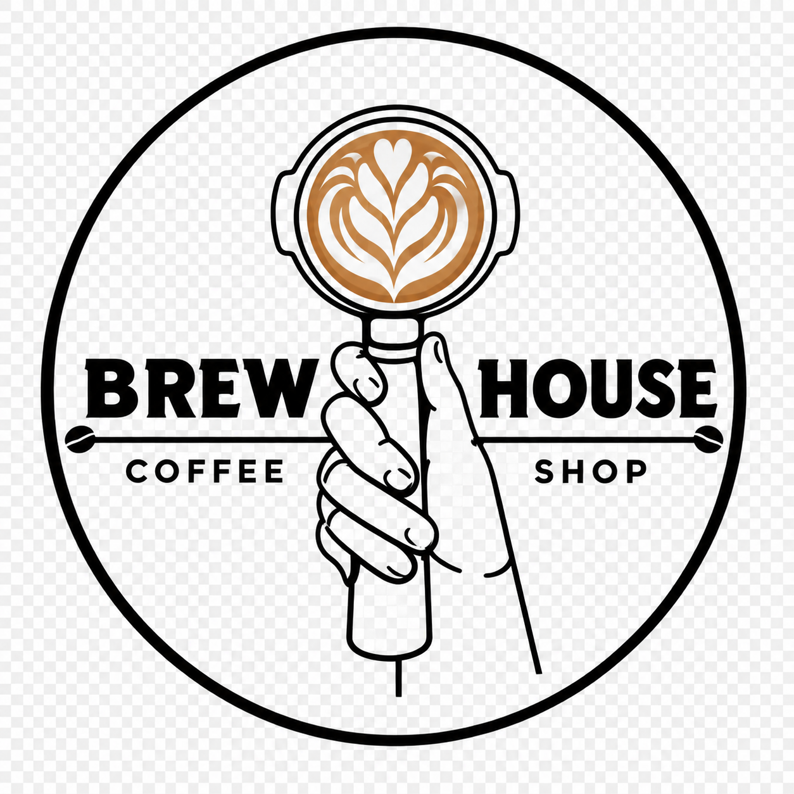

# ☕ Brew House Coffee Shop — Site Oficial

<div align="center">



**Cafés Especiais · Brunch · Doces Artesanais**  
*Santo Amaro, São Paulo — SP*

[](https://developer.mozilla.org/en-US/docs/Web/HTML)
[](https://developer.mozilla.org/en-US/docs/Web/CSS)
[](https://developer.mozilla.org/en-US/docs/Web/JavaScript)

</div>

---

## 📋 Sobre o Projeto

Site institucional da **Brew House Coffee Shop**, uma cafeteria aconchegante localizada em Santo Amaro, São Paulo. O site foi desenvolvido para apresentar o espaço, o cardápio e facilitar o contato com os clientes.

### ✨ Destaques
- Design moderno com **glassmorphism** e **modo escuro**
- Totalmente **responsivo** para todos os dispositivos
- **Animações suaves** com Intersection Observer API
- **Formulário de contato** integrado ao WhatsApp
- **SEO otimizado** com meta tags e estrutura semântica
- **Zero dependências externas** — HTML, CSS e JS puro

---

## 🚀 Funcionalidades

| Seção | Descrição |
|-------|-----------|
| 🏠 **Hero** | Foto de capa com partículas animadas e chamada para ação |
| 📖 **Sobre** | História e diferenciais da cafeteria |
| 🍽️ **Cardápio** | Sistema de abas com Brunch, Cafés & Bebidas, Doces & Tortas |
| 🌟 **Experiência** | Wi-Fi, Pet Friendly, Acessibilidade, Delivery e mais |
| ⭐ **Avaliações** | Reviews reais do Google com nota 5.0 (+214 avaliações) |
| 📍 **Contato** | Formulário WhatsApp, mapa interativo e horários |

---

## 🛠️ Tecnologias Utilizadas

- **HTML5** — Estrutura semântica e acessível
- **CSS3** — Design system com variáveis, animações e responsividade
- **JavaScript ES6+** — Interatividade sem frameworks
- **Google Fonts** — Playfair Display + Inter + DM Sans
- **Google Maps Embed** — Mapa interativo na seção de contato

---

## 📁 Estrutura do Projeto

```
Coffee-shop/
├── index.html              # Página principal
├── style.css               # Estilos globais e design system
├── main.js                 # Scripts de interatividade
├── README.md               # Documentação do projeto
├── .gitignore              # Arquivos ignorados pelo Git
└── assets/
    └── images/             # Imagens do projeto
        ├── logotipo.png    # Logo da cafeteria
        ├── capa-hero.png   # Foto de capa da hero
        ├── interior.png    # Foto do interior
        ├── brunch-*.jpg    # Fotos do cardápio (brunch)
        ├── cafe-*.jpg      # Fotos do cardápio (cafés)
        ├── torta-*.jpg     # Fotos das tortas
        └── exp-*.jpg       # Fotos da seção experiência
```

---

## 🖥️ Como Executar Localmente

O projeto é **100% estático** — basta abrir o arquivo no navegador:

```bash
# Clone o repositório
git clone https://github.com/Tamiris-Serafim/Coffee-shop.git

# Acesse a pasta
cd Coffee-shop

# Abra no navegador (duplo clique) ou use um servidor local
# Com VS Code + extensão Live Server:
# Clique com botão direito em index.html → Open with Live Server
```

---

## 📍 Informações da Cafeteria

| | |
|---|---|
| 📍 **Endereço** | Rua Amador Bueno, 757 — Santo Amaro, São Paulo/SP |
| ⏰ **Seg a Sex** | 9h às 17h |
| ⏰ **Sábado** | 9h às 16h |
| ⏰ **Dom / Feriados** | 9h às 14h |
| 📞 **Telefone** | (11) 4172-6558 |
| ✉️ **E-mail** | cafeteria.brewhouse@gmail.com |
| 📸 **Instagram** | [@cafeteria.brewhouse](https://www.instagram.com/cafeteria.brewhouse/) |

---

## 🎨 Design System

```css
/* Paleta de cores principal */
--caramel:       hsl(33, 56%, 54%);   /* Tom principal */
--caramel-dark:  hsl(28, 62%, 38%);   /* Hover / CTA */
--caramel-light: hsl(36, 72%, 72%);   /* Destaques */
--deep-espresso: hsl(24, 50%, 18%);   /* Fundo escuro */
--cream:         hsl(42, 38%, 94%);   /* Fundo claro */
--sage:          hsl(95, 22%, 42%);   /* Badges */
```

---

## 📄 Licença

Este projeto foi desenvolvido para fins educacionais e comerciais.  
© 2024 Brew House Coffee Shop — Todos os direitos reservados.

---

<div align="center">
  Desenvolvido com ☕ e muito carinho por <a href="https://github.com/Tamiris-Serafim">Tamiris Serafim</a>
</div>
